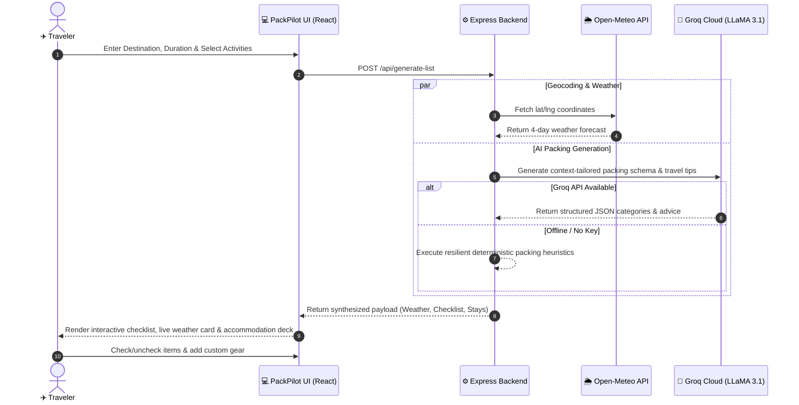
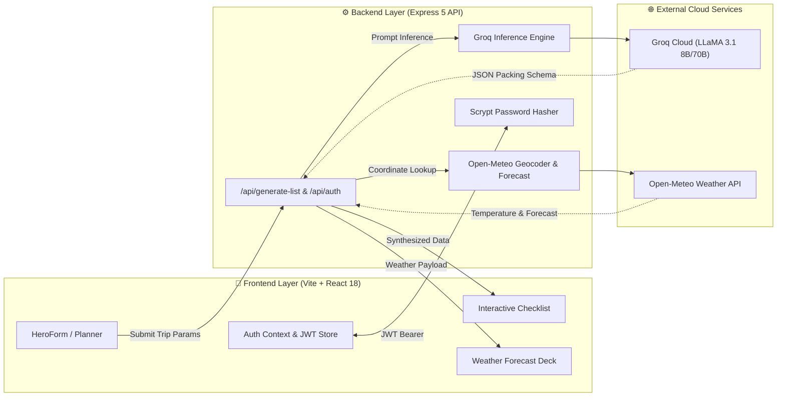

<div align="center">

# 🧳 PackPilot

### *The Intelligent, AI-Driven Travel Itinerary & Smart Packing Assistant*

<p align="center">
  <b>Plan smarter. Pack lighter. Travel further.</b>
</p>

<!-- Badges Row 1: Core Tech -->
<p align="center">
  <a href="https://react.dev/"></a>
  <a href="https://vitejs.dev/"></a>
  <a href="https://tailwindcss.com/"></a>
  <a href="https://nodejs.org/"></a>
  <a href="https://expressjs.com/"></a>
  <a href="https://groq.com/"></a>
</p>

<!-- Badges Row 2: Repository Metrics -->
<p align="center">
  <a href="https://github.com/HK2184/packpilot/stargazers"></a>
  <a href="https://github.com/HK2184/packpilot/network/members"></a>
  <a href="https://github.com/HK2184/packpilot/issues"></a>
  <a href="https://github.com/HK2184/packpilot/blob/main/LICENSE"></a>
  
</p>

---

<!-- Quick Navigation Pill Bar -->
<p align="center">
  <a href="#-interactive-demo--walkthrough"><b>🎮 Interactive Demo</b></a> •
  <a href="#-key-features"><b>✨ Features</b></a> •
  <a href="#-interactive-architecture--flow"><b>📊 Architecture Flow</b></a> •
  <a href="#-quickstart-guide"><b>🚀 Quickstart</b></a> •
  <a href="#-interactive-api-explorer"><b>📡 API Explorer</b></a> •
  <a href="#-why-packpilot-comparison"><b>⚖️ Why PackPilot?</b></a> •
  <a href="#-roadmap"><b>🗺️ Roadmap</b></a>
</p>

---

</div>

## 💡 Overview

**PackPilot** is an end-to-end full-stack web application engineered to solve pre-travel anxiety. Instead of static, generic packing checklists, PackPilot dynamically analyzes:
- 📍 **Destination Geography & Climate** (via Open-Meteo Geocoding & live multi-day forecasts)
- ⏱️ **Trip Duration** (dynamically computing required tops, bottoms, underwear, and laundry cycles)
- 🎯 **Planned Activities** (Beach, Alpine/Snow, Business Conferences, Rugged Hiking, Urban Sightseeing)
- 🧠 **Groq-Accelerated LLM Intelligence** (powered by LLaMA 3.1 ultra-low-latency inference)

Whether you are preparing for a weekend business summit in Tokyo or a 14-day trekking journey in the Swiss Alps, PackPilot delivers an interactive checklist, local accommodation options, and live meteorological context in seconds.

---

## 🎮 Interactive Demo & Walkthrough

<details open>
<summary><b>🎬 How PackPilot Works (Step-by-Step Flow)</b> <i>[Click to collapse/expand]</i></summary>

<br />



</details>

---

## ✨ Key Features

<table>
  <tr>
    <td width="50%">
      <h3>🤖 Groq LLaMA 3.1 AI Generation</h3>
      <p>Uses ultra-fast inference to construct custom, context-aware packing recommendations and destination tips tailored to cultural customs, weather, and specific activities.</p>
    </td>
    <td width="50%">
      <h3>⚡ Heuristic Fallback Engine</h3>
      <p>Zero downtime design. If the AI service is unreachable, an algorithmic fallback calculates clothing equations based on trip length and builds comprehensive category kits.</p>
    </td>
  </tr>
  <tr>
    <td width="50%">
      <h3>🌦️ Real-Time Meteorological Intel</h3>
      <p>Direct integration with Open-Meteo provides real-time temperatures, condition glyphs, and a 4-day daily forecast with high/low margins.</p>
    </td>
    <td width="50%">
      <h3>🏨 Localized Accommodations</h3>
      <p>Integrated lodging recommendations display top-rated hotels, motels, and hostels with price tier badges and star ratings.</p>
    </td>
  </tr>
  <tr>
    <td width="50%">
      <h3>✅ Dynamic Checklist & Progress Tracker</h3>
      <p>Instant category filters (Essentials, Clothing, Toiletries, Tech, Activity gear), real-time progress bar, packed counters, and custom item insertion.</p>
    </td>
    <td width="50%">
      <h3>🔐 Cryptographic JWT Auth</h3>
      <p>Stateless authentication using JSON Web Tokens with salted scrypt hashing for secure registration, login, and profile tracking.</p>
    </td>
  </tr>
</table>

---

## 🔍 Feature Deep Dive (Interactive Tabs)

<details>
<summary><b>🧠 1. AI vs Deterministic Heuristic Engine</b></summary>

<br />

PackPilot offers a resilient two-tier packing generation pipeline:

1. **Tier 1 (Groq Cloud LLaMA 3.1)**:
   - Employs strict JSON prompt schema enforcement.
   - Synthesizes temperature trends, destination quirks, and activity-specific necessities (e.g. universal power adapters, medication, thermal base layers).
2. **Tier 2 (Deterministic Rule-Based Fallback)**:
   - Calculates clothing formulas:
     $$\text{Tops} = \min(14, \max(2, \lceil\text{days} \times 0.7\rceil + 1))$$
     $$\text{Bottoms} = \max(1, \lceil\text{days} / 3\rceil)$$
     $$\text{Underwear} = \min(14, \max(2, \text{days} + 1))$$
   - Appends contextual kits for Beach, Snow, Business, Hiking, and Photography.

</details>

<details>
<summary><b>🌦️ 2. Live Weather Forecast Integration</b></summary>

<br />

- **Geocoding**: Translates destination text (e.g., *"Kyoto, Japan"*, *"Reykjavik"*) into exact GPS coordinates via Open-Meteo Geocoding.
- **WMO Code Mapping**: Decodes international WMO weather codes into human-readable conditions and descriptive icons (☀️ Clear, 🌤️ Mostly clear, 🌧️ Rain, ❄️ Snow, ⛈️ Thunderstorm).
- **Multi-Day Planning**: Supplies minimum and maximum expected temperatures in Celsius for immediate packing adjustment.

</details>

<details>
<summary><b>🛡️ 3. Authentication & Security Architecture</b></summary>

<br />

- **Password Storage**: Uses Node.js native `crypto.scryptSync` with unique 16-byte cryptographically secure salts (`crypto.randomBytes(16)`).
- **Timing Safe Verification**: Uses `crypto.timingSafeEqual` to eliminate timing attacks during authentication checks.
- **Stateless Tokens**: Signs 7-day expiration JSON Web Tokens (`jwt.sign`) with HMAC-SHA256.

</details>

---

## 📊 Interactive Architecture & Flow



---

## ⚖️ Why PackPilot? (Comparison)

| Feature | Generic Notes App | Standard Packing Apps | 🧳 **PackPilot** |
|:---|:---:|:---:|:---:|
| **Dynamic Weather Sync** | ❌ Manual | ❌ Static / None | ✅ **Live Multi-Day Forecast** |
| **Duration-Scaled Clothing Math** | ❌ None | ⚠️ Fixed Presets | ✅ **Algorithmic Clothing Ratios** |
| **AI Activity Context** | ❌ None | ❌ None | ✅ **Groq LLaMA 3.1 Custom Tips** |
| **Offline Fallback Guarantee** | ⚠️ Blank | ❌ Cloud Only | ✅ **Built-in Heuristic Engine** |
| **Local Accommodation Ideas** | ❌ None | ❌ None | ✅ **Curated Hotel Stays** |
| **Interactive Progress Bar** | ❌ None | ⚠️ Basic | ✅ **Category-Grouped Checklists** |
| **Zero Vendor Lock-in** | ✅ High | ❌ Low | ✅ **Open Source & Extensible** |

---

## 🚀 Quickstart Guide

> [!TIP]
> You can run PackPilot in less than 2 minutes! A Groq API key is optional — the app will gracefully fall back to its internal heuristic engine if no key is provided.

<details open>
<summary><b>🛠️ Step-by-Step Installation</b></summary>

<br />

### 1. Clone the Repository

```bash
git clone https://github.com/HK2184/packpilot.git
cd packpilot
```

### 2. Configure & Run Backend

```bash
# Navigate to backend directory
cd trip-planner-backend

# Install dependencies
npm install

# Setup environment variables
cp .env.example .env

# (Optional) Add your GROQ_API_KEY in .env

# Start server in watch mode
npm run dev
```

*Backend server will launch at: `http://localhost:5000`*

### 3. Configure & Run Frontend

Open a new terminal window in the root directory:

```bash
# In the root repository folder:
npm install

# Setup environment variables
cp .env.example .env

# Start the Vite development server
npm run dev
```

*Frontend web app will launch at: `http://localhost:5173`*

</details>

<details>
<summary><b>📦 Production Deployment & Build</b></summary>

<br />

Compile production-optimized, tree-shaken static assets:

```bash
npm run build
```

Assets are built to `dist/`, ready to deploy on:
- [Vercel](https://vercel.com/)
- [Netlify](https://www.netlify.com/)
- [Cloudflare Pages](https://pages.cloudflare.com/)
- [GitHub Pages](https://pages.github.com/)

Preview your production build locally:

```bash
npm run preview
```

</details>

---

## 📡 Interactive API Explorer

<details open>
<summary><b>POST /api/generate-list</b> — Generate Trip Plan, Weather & Packing List</summary>

<br />

**Request Headers**: `Content-Type: application/json`

**Sample cURL**:
```bash
curl -X POST http://localhost:5000/api/generate-list \
  -H "Content-Type: application/json" \
  -d '{
    "destination": "Kyoto, Japan",
    "durationDays": 5,
    "activities": ["📸 Sightseeing", "🏖️ Beach"]
  }'
```

**Response Preview**:
```json
{
  "ok": true,
  "destination": "Kyoto, Japan",
  "durationDays": 5,
  "activities": ["📸 Sightseeing", "🏖️ Beach"],
  "packingData": [
    {
      "title": "🛂 Essentials",
      "items": [
        { "id": 1, "name": "Passport / ID (and a photo copy)", "packed": false },
        { "id": 2, "name": "Wallet + payment method", "packed": false }
      ]
    },
    {
      "title": "👕 Clothing",
      "items": [
        { "id": 6, "name": "Tops & shirts (5x)", "packed": false },
        { "id": 7, "name": "Bottoms (2x)", "packed": false }
      ]
    }
  ],
  "aiTips": [
    "Carry small cash notes as many historic temples and shrines accept cash only.",
    "Wear comfortable slip-on shoes for temple visits where footwear must be removed."
  ],
  "weather": {
    "location": { "name": "Kyoto", "country": "Japan" },
    "current": { "tempC": 21.5, "icon": "☀️", "text": "Clear" },
    "daily": [
      { "date": "2026-09-28", "icon": "☀️", "text": "Clear", "maxC": 25.1, "minC": 15.3 }
    ]
  },
  "hotels": [
    { "name": "Kyoto Grand Palace", "price": "$140/night", "rating": "4.8 ★" }
  ]
}
```

</details>

<details>
<summary><b>POST /api/auth/register & /api/auth/login</b> — Authentication Endpoints</summary>

<br />

**Request Body**:
```json
{
  "email": "traveler@packpilot.io",
  "password": "supersecretpassword"
}
```

**Response**:
```json
{
  "ok": true,
  "token": "eyJhbGciOiJIUzI1NiIsInR5cCI6IkpXVCJ9...",
  "user": {
    "id": "e4b6c318-7359-450f-90e6-121f0ce51fa8",
    "email": "traveler@packpilot.io",
    "createdAt": "2026-09-27T07:45:00.000Z"
  }
}
```

</details>

<details>
<summary><b>GET /api/health</b> — Microservice Health Check</summary>

<br />

```bash
curl http://localhost:5000/api/health
```

**Response**:
```json
{
  "ok": true,
  "service": "trip-planner-backend"
}
```

</details>

---

## ⚙️ Environment Configuration

| Variable | Scope | Required? | Default | Description |
|---|---|:---:|---|---|
| `VITE_BACKEND_URL` | Frontend | No | `http://localhost:5000` | Target URL for backend API requests |
| `PORT` | Backend | No | `5000` | Port for Express server |
| `GROQ_API_KEY` | Backend | Optional | `""` *(fallback active)* | Groq Cloud inference API key |
| `GROQ_MODEL` | Backend | No | `llama-3.1-8b-instant` | Groq LLM model name |
| `JWT_SECRET` | Backend | No | Random 32-byte hex | Cryptographic signing secret for JWTs |
| `ADMIN_EMAIL` | Backend | No | `admin@example.com` | Default admin email |
| `ADMIN_PASSWORD` | Backend | No | `changeme` | Default admin password |

---

## 🗺️ Roadmap & Upcoming Enhancements

- [x] **AI-Powered Packing Generation** (Groq LLaMA 3.1)
- [x] **Open-Meteo Live Forecast & Geocoding**
- [x] **Deterministic Fallback Algorithm**
- [x] **Interactive Category Checklists & Real-Time Progress Bar**
- [x] **Cryptographic Scrypt User Authentication & JWT Sessions**
- [ ] **Multi-City Itinerary Support** *(Combine packing needs for multiple climates)*
- [ ] **Export to PDF & Notion** *(One-click printable PDF travel manifest)*
- [ ] **Offline PWA Support** *(Full service-worker offline caching)*
- [ ] **Group / Family Trip Sync** *(Collaborative shared checklists)*
- [ ] **Luggage Weight Estimator** *(Approximate pack weight calculations)*

---

## 🤝 Contributing

Contributions make the open-source community an inspiring place to learn and innovate. Any contributions you make are **greatly appreciated**!

1. **Fork the Repository**
2. **Create your Feature Branch** (`git checkout -b feature/EpicNewFeature`)
3. **Commit your Changes** (`git commit -m 'feat: Add EpicNewFeature'`)
4. **Push to the Branch** (`git push origin feature/EpicNewFeature`)
5. **Open a Pull Request**

---

## 📄 License

Distributed under the **MIT License**. See [`LICENSE`](LICENSE) for more information.

<div align="center">

---

Built with ❤️ by [HK2184](https://github.com/HK2184) & [PRIME1895](https://github.com/PRIME1895)

<b>⭐ If you find PackPilot useful, please consider giving it a star on GitHub! ⭐</b>

</div>
