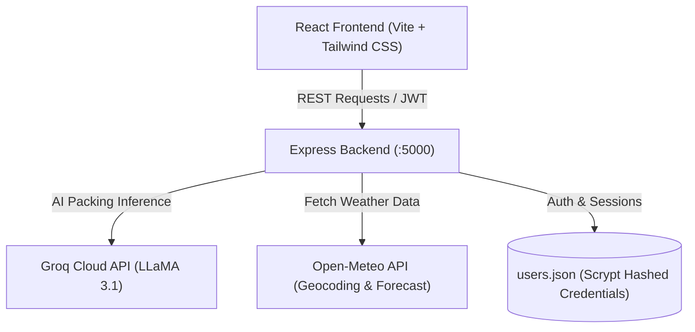

# 🧳 PackPilot — Smart AI Trip Planner & Packing Assistant

<p align="center">
  
  
  
  
  
  
  
</p>

PackPilot is a modern full-stack travel companion application that takes the stress out of travel planning. By analyzing your destination, trip length, and planned activities, PackPilot automatically generates tailored packing checklists, pulls live weather forecasts, and suggests top-rated accommodations.

---

## 📑 Table of Contents

- [Features](#-features)
- [Architecture & Tech Stack](#-architecture--tech-stack)
- [Project Directory Structure](#-project-directory-structure)
- [Getting Started](#-getting-started)
  - [Prerequisites](#prerequisites)
  - [Clone Repository](#1-clone-the-repository)
  - [Backend Setup](#2-backend-setup)
  - [Frontend Setup](#3-frontend-setup)
- [Environment Variables](#-environment-variables)
- [API Reference](#-api-reference)
- [Production Build](#-production-build)
- [Contributing](#-contributing)
- [License](#-license)

---

## ✨ Features

- **🤖 AI-Powered Checklist Generation**: Leverages Groq's high-speed inference running **LLaMA 3.1** to construct personalized, context-aware packing lists and actionable travel tips based on your destination and activities.
- **⚡ Resilient Fallback Engine**: If the AI API is offline or unconfigured, an intelligent heuristic fallback algorithm automatically computes clothing amounts (scaled to trip duration), essential travel documents, and activity-specific gear.
- **🌦️ Real-Time Weather Integration**: Queries the Open-Meteo Geocoding and Weather Forecast APIs to display current temperatures, weather conditions, and a 4-day forecast for the destination.
- **🏨 Accommodation Finder**: Delivers curated hotel and lodging recommendations tailored to your destination with price tiers and review ratings.
- **✅ Interactive Packing Checklist**:
  - Filter items by category: Essentials, Clothing, Toiletries, Tech, Beach, Hiking, Business, Snow, and Sightseeing.
  - Interactive checkboxes with instant completion counters and dynamic visual progress bars.
  - Add custom items dynamically to any trip checklist.
- **🔐 Secure Authentication**: Full user signup, signin, and JWT session handling backed by cryptographic password hashing using Node.js `scrypt` with random salt generation.
- **🧭 Explore & Travel Deals**: Explore popular global destinations and access travel deals on flights and hotels.
- **🎨 Responsive Modern Design**: Styled with Tailwind CSS, clean cards, subtle animations, and modern typography powered by *Plus Jakarta Sans*.

---

## 🛠 Architecture & Tech Stack



### Frontend
- **Framework**: [React 18](https://react.dev/)
- **Routing**: [React Router v7](https://reactrouter.com/)
- **Bundler & Dev Server**: [Vite 5](https://vitejs.dev/)
- **Styling**: [Tailwind CSS 3](https://tailwindcss.com/) & [PostCSS](https://postcss.org/)
- **Typography**: Google Fonts (*Plus Jakarta Sans*)

### Backend
- **Runtime**: [Node.js](https://nodejs.org/) (ES Modules & CommonJS compatibility)
- **Framework**: [Express 5](https://expressjs.com/)
- **Authentication**: [JSON Web Tokens (JWT)](https://jwt.io/) & Node.js `crypto` (`scryptSync`)
- **External Integrations**:
  - [Groq SDK / REST API](https://groq.com/) for LLaMA 3.1 inference
  - [Open-Meteo API](https://open-meteo.com/) for location search and live multi-day forecasts

---

## 📂 Project Directory Structure

```text
├── .env.example               # Example root environment variables
├── .gitignore                  # Git ignore rules for node_modules, dist, .env
├── index.html                 # Single page application HTML entry point
├── package.json               # Root frontend dependencies & scripts
├── postcss.config.js          # PostCSS configuration for Tailwind CSS
├── tailwind.config.js         # Tailwind theme & content configuration
├── vite.config.js             # Vite configuration with custom JSX plugins
├── frontend.js                # Core PackPilot planner & checklist component
│
├── src/
│   ├── App.jsx                # Application routing configuration
│   ├── main.jsx               # React entry point
│   ├── index.css              # Global styles and Tailwind directives
│   ├── auth/
│   │   └── AuthContext.jsx    # React Context for JWT auth state & token storage
│   ├── components/
│   │   └── SiteLayout.jsx     # Global layout header, navigation, and footer
│   └── pages/
│       ├── Deals.jsx          # Travel offers & discounts page
│       ├── Explore.jsx        # Destination inspiration & travel guide
│       ├── Login.jsx          # User login screen
│       ├── Register.jsx       # User registration screen
│       ├── Support.jsx        # FAQs and customer support
│       ├── Terms.jsx          # Terms of service
│       ├── Privacy.jsx        # Privacy policy
│       └── NotFound.jsx       # 404 handler
│
└── trip-planner-backend/      # Express API server
    ├── .env.example           # Example backend environment variables
    ├── package.json           # Backend dependencies and startup scripts
    └── server.js              # Express API server, Groq AI, and weather logic
```

---

## 🚀 Getting Started

### Prerequisites

Ensure you have the following installed on your machine:
- **Node.js** (v18.0.0 or higher recommended)
- **npm** (v9.0.0 or higher) or **yarn** / **pnpm**
- *(Optional)* A [Groq Cloud API Key](https://console.groq.com) for AI-generated lists.

---

### 1. Clone the Repository

```bash
git clone https://github.com/HK2184/packpilot.git
cd packpilot
```

---

### 2. Backend Setup

1. Navigate to the backend directory:
   ```bash
   cd trip-planner-backend
   ```

2. Install dependencies:
   ```bash
   npm install
   ```

3. Create the environment configuration file:
   ```bash
   cp .env.example .env
   ```

4. Edit `.env` and set your configuration values:
   ```env
   PORT=5000
   GROQ_API_KEY=your_groq_api_key_here
   GROQ_MODEL=llama-3.1-8b-instant
   JWT_SECRET=your_jwt_secret_key_here
   ADMIN_EMAIL=admin@example.com
   ADMIN_PASSWORD=changeme
   ```
   > **Note:** If `GROQ_API_KEY` is omitted, PackPilot will automatically fall back to its built-in rule-based packing algorithm without crashing.

5. Start the backend server:
   ```bash
   npm run dev
   # Server will start on http://localhost:5000
   ```

---

### 3. Frontend Setup

1. In a new terminal window, navigate back to the root project directory:
   ```bash
   cd ..
   ```

2. Install frontend dependencies:
   ```bash
   npm install
   ```

3. Create the frontend environment configuration file:
   ```bash
   cp .env.example .env
   ```

4. Verify `.env` points to your backend:
   ```env
   VITE_BACKEND_URL=http://localhost:5000
   ```

5. Launch the Vite development server:
   ```bash
   npm run dev
   ```

6. Open your browser and navigate to `http://localhost:5173`.

---

## ⚙️ Environment Variables

### Frontend (`.env`)

| Variable | Type | Default | Description |
|---|---|---|---|
| `VITE_BACKEND_URL` | String | `http://localhost:5000` | Base URL pointing to the Express backend API |

### Backend (`trip-planner-backend/.env`)

| Variable | Type | Default | Description |
|---|---|---|---|
| `PORT` | Number | `5000` | Port on which the Express server listens |
| `GROQ_API_KEY` | String | *(Optional)* | API Key from Groq Cloud for AI list generation |
| `GROQ_MODEL` | String | `llama-3.1-8b-instant` | Groq LLM model identifier |
| `JWT_SECRET` | String | Random 32-byte hex | Secret key for signing and verifying JWT tokens |
| `ADMIN_EMAIL` | String | `admin@example.com` | Default admin email |
| `ADMIN_PASSWORD` | String | `changeme` | Default admin password |

---

## 📡 API Reference

### Health Check
- **`GET /api/health`**
  - Response: `{ "ok": true, "service": "trip-planner-backend" }`

### Authentication
- **`POST /api/auth/register`**
  - Body: `{ "email": "user@example.com", "password": "securepassword" }`
  - Response: `{ "ok": true, "token": "<JWT_TOKEN>", "user": { "id": "...", "email": "..." } }`

- **`POST /api/auth/login`**
  - Body: `{ "email": "user@example.com", "password": "securepassword" }`
  - Response: `{ "ok": true, "token": "<JWT_TOKEN>", "user": { "id": "...", "email": "..." } }`

- **`GET /api/auth/me`**
  - Headers: `Authorization: Bearer <JWT_TOKEN>`
  - Response: `{ "ok": true, "user": { "id": "...", "email": "..." } }`

### Trip Planner & Packing Generator
- **`POST /api/generate-list`**
  - Body:
    ```json
    {
      "destination": "Kyoto, Japan",
      "durationDays": 7,
      "activities": ["📸 Sightseeing", "🥾 Hiking"]
    }
    ```
  - Response:
    ```json
    {
      "ok": true,
      "packingData": [
        {
          "title": "🛂 Essentials",
          "items": [
            { "id": 1, "name": "Passport / ID", "packed": false }
          ]
        }
      ],
      "aiTips": ["Carry small cash notes as many shrines only accept cash."],
      "weather": {
        "location": { "name": "Kyoto", "country": "Japan" },
        "current": { "tempC": 22.4, "icon": "☀️", "text": "Clear" },
        "daily": [...]
      },
      "hotels": [...]
    }
    ```

---

## 📦 Production Build

To produce an optimized production bundle of the frontend:

```bash
npm run build
```

The compiled files will be output to the `dist/` directory, ready to be deployed on static hosting services (Vercel, Netlify, Cloudflare Pages, GitHub Pages) or served directly through a reverse proxy (e.g. Nginx).

To preview the production build locally:

```bash
npm run preview
```

---

## 🤝 Contributing

Contributions, issues, and feature requests are welcome!
1. Fork the Project.
2. Create your Feature Branch (`git checkout -b feature/AmazingFeature`).
3. Commit your Changes (`git commit -m 'Add some AmazingFeature'`).
4. Push to the Branch (`git push origin feature/AmazingFeature`).
5. Open a Pull Request.

---

## 📄 License

This project is open source and available under the [MIT License](LICENSE).
